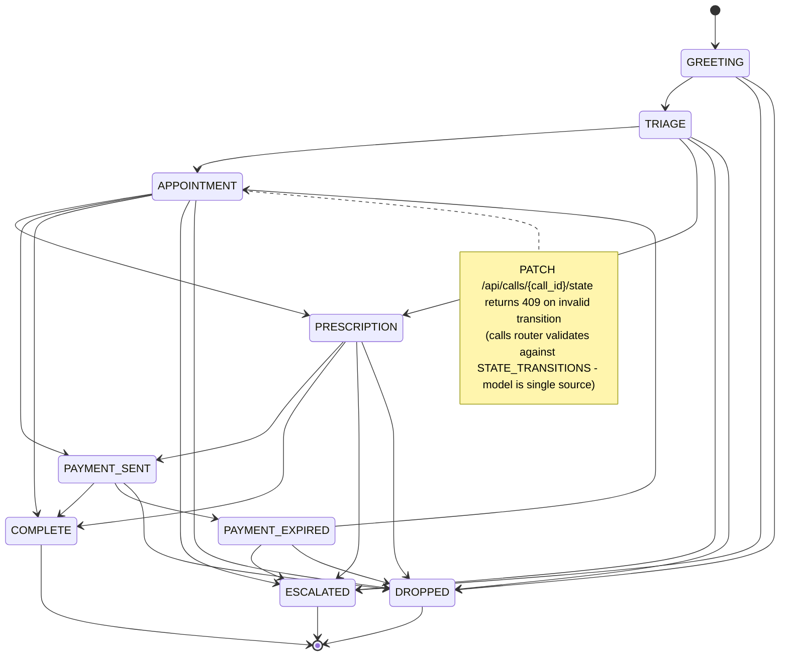

# 02 — Call State Machine

## Notes

- **Single source**: `backend/app/models/call.py` — `CallState` enum (9 states) +
  `STATE_TRANSITIONS` dict. `backend/tests/test_uml_diagrams.py` parses the dict
  via `ast` and asserts the mermaid edge set **equals** it, so this diagram cannot
  drift from the code.
- **Terminal states**: `COMPLETE`, `ESCALATED`, `DROPPED` have no outgoing
  transitions.
- **Payment loop (G6-Q5 wired)**: `PRESCRIPTION` and `APPOINTMENT` → `PAYMENT_SENT`
  → `PAYMENT_EXPIRED` → back to `APPOINTMENT`. Live gateway SDK calls are
  env-gated (501 without keys, spec-payments.md Q5/A5a); the unified webhook
  (`POST /api/payments/webhook`, per-gateway HMAC + service token, idempotent
  by `gateway_ref`) advances captured intents and moves the linked call
  `PAYMENT_SENT → COMPLETE`.
- **Escalation guardrails (G6-Q3 wired)**: independent of the LLM — a red-flag
  keyword in the caller's words (12-category catalog in
  `app/services/guardrails.py`) escalates deterministically (temperature≈0
  path, per-language handoff phrase), and every agent reply is scanned for
  diagnosis/dosage claims before TTS (fixed per-language refusal phrase).
- **API enforcement**: the calls router's `PATCH /{call_id}/state` rejects invalid
  transitions with 409 (covered by `test_api_routes.py`).