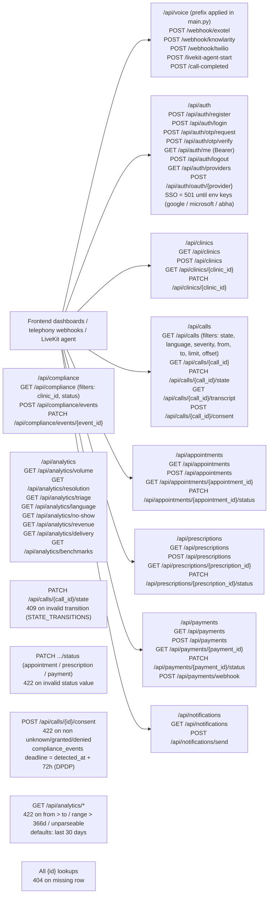

# 03 — API Contracts

## Notes

- Three routers (clinics, calls, appointments, prescriptions, payments — five
  modules) each declare `APIRouter(prefix="/api/<name>")`; `voice` is registered
  with the `/api/voice` prefix and `auth` with `prefix="/api/auth"` in `main.py`
  (all ten routers included).
- This endpoint set is the executable contract in
  `backend/tests/test_api_routes.py` (`EXPECTED_ENDPOINTS`) and the basis for the
  Docker/CI HTTP smoke tests.
- Contract behaviors: 409 invalid state transition, 422 invalid status, 404
  missing row — all acceptance-tested.
- Auth contract (G6-Q1, spec-auth.md): password + OTP are live
  (`/api/auth/register|login|otp/*`); `GET /me` requires a Bearer JWT;
  SSO (`/oauth/{provider}`) returns 501 until the Google/Microsoft/ABHA env
  keys are configured.
- **Enforcement (spec-auth-enforcement.md): every domain endpoint on the five
  routers is identity-gated** — a Bearer JWT is required (401 without it; the
  JWT's `sub` sets the per-request RLS GUC `app.current_user_id`). Only
  `POST /api/clinics` additionally demands the platform `owner` role (403 for
  staff); the creator automatically becomes the clinic's owner. Unauthenticated
  calls, staff clinic-creation, and expired/invalid tokens are all smoke-tested.
- **Voice webhooks (`/api/voice/*`) are service-token gated** — every callback
  must send `X-Service-Token` == `WEBHOOK_SERVICE_TOKEN` (env; dev default
  `dev-service-token`) or it 401s. Verified requests run the transcript write
  under the server-side `app.service_request` RLS bypass (`calls_update`).
- **Postgres connects as the non-owner `medicall_app` role; all 7 tenant tables
  have RLS FORCED** — row visibility is scoped by `clinic_users` membership
  (identity GUC) rather than by application filtering. The seeded demo owner is
  `+919876543210` / `DemoPass!2026` (creates + owns "City Care Demo").
- **Payments (G6-Q5 wired, spec-payments.md): consultations + prescription
  refills bill.** `POST /api/payments` records the intent (kind: consultation /
  refill / subscription) and dispatches the gateway request only when the
  gateway's env keys are present (501 otherwise — `manual` stays keyless).
  `POST /api/payments/webhook` is **identity-free by design**: verified by the
  shared `X-Service-Token` AND the per-gateway signature (`X-Razorpay-Signature`
  HMAC-SHA256 / PhonePe `X-VERIFY` / Cashfree `X-Verify-Hmac-Sha256`), writes
  run under the `app.service_request` RLS bypass, and it is idempotent by
  `gateway_ref` (unique partial index). On `captured` the linked call in
  `PAYMENT_SENT` advances to `COMPLETE`.
- **Notifications (G6-Q8 wired, spec-notifications-q8.md): WhatsApp-first
  messaging with SMS/email fallback per kind and per-language templates for
  all 5 languages.** `POST /api/notifications/send` is identity-gated and 501s
  when no channel has keys (Q3=A3a env gate); `GET /api/notifications` lists a
  clinic's delivery trail. The payment-create hook fires the `payment_link`
  leg to the caller's phone — a recorded, non-fatal side effect that never
  fails a payment. Rows land in the `notifications` table under the
  `notifications_send` policy (membership OR `app.service_request` bypass).
- **Compliance (G6-Q2 wired, spec-dpdp-q2.md): DPDP consent + 72-hr breach
  flow + retention.** `POST /api/calls/{call_id}/consent` sets the per-call
  recording-consent flag (unknown/granted/denied, 422 otherwise) riding the
  existing calls RLS; the in-call capture helper is `services/consent.py`
  (`parse_consent_response` for all 5 languages, `recording_allowed` is the
  LiveKit egress gate). `POST /api/compliance/events` stores data_breach /
  consent_withdrawal / gdpr_request rows with their computed
  `notification_deadline` (= detected_at + 72h); PATCH moves status
  open → reported → closed. The actual DPB/affected-user alert is an
  operational follow-on (Q8 email channel). Retention per kind
  (`services/retention.py`, env-overridable) is enforced by
  `postgres.purge_expired` from the Docker/CI cron.
- **Analytics (G6-Q9 wired, spec-kpis-q9.md): per-KPI endpoints under
  `/api/analytics`** (Q2=A2) — one GET per KPI: volume (total/by_state/by_day/
  avg duration), resolution rate (COMPLETE over terminal; PAYMENT_SENT
  excluded as in-progress), triage mix (green/amber/red/critical + untriaged),
  language dist (hi/en/ta/te/bn + unknown), no-show rate (over terminal
  appointments), revenue (captured/refunded/by_kind/currency), delivery
  success (per notification kind). `/benchmarks` serves the static
  market-context cards (2026: Hyro FCR 70-79%, Interactly 72%,
  no-show India 18-25% → voice-target 8-12%, confirmation 75-85%) — display
  only, never enforced. Pure computed (Q3=A1): read-only aggregates over
  calls/appointments/payments/notifications riding their RLS, zero schema
  writes; period = optional from/to (default last 30 days, 366-day cap,
  422 on bad order/over-cap/unparseable, naive assumed UTC).