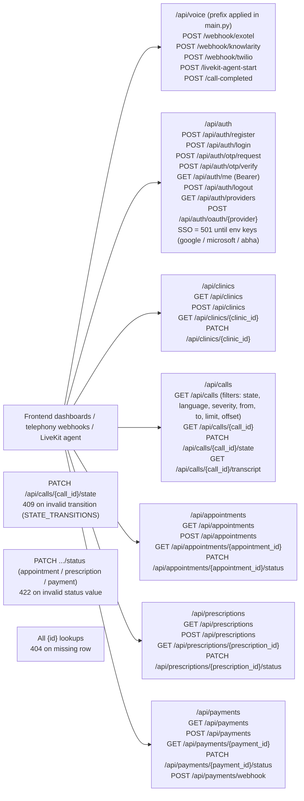

# 03 — API Contracts

## Notes

- Three routers (clinics, calls, appointments, prescriptions, payments — five
  modules) each declare `APIRouter(prefix="/api/<name>")`; `voice` is registered
  with the `/api/voice` prefix and `auth` with `prefix="/api/auth"` in `main.py`
  (all seven routers included).
- This endpoint set is the executable contract in
  `backend/tests/test_api_routes.py` (`EXPECTED_ENDPOINTS`) and the basis for the
  Docker/CI HTTP smoke tests.
- Contract behaviors: 409 invalid state transition, 422 invalid status, 404
  missing row — all acceptance-tested.
- Auth contract (G6-Q1, spec-auth.md): password + OTP are live
  (`/api/auth/register|login|otp/*`); `GET /me` requires a Bearer JWT;
  SSO (`/oauth/{provider}`) returns 501 until the Google/Microsoft/ABHA env
  keys are configured.
- **Enforcement (spec-auth-enforcement.md): every domain endpoint on the five
  routers is identity-gated** — a Bearer JWT is required (401 without it; the
  JWT's `sub` sets the per-request RLS GUC `app.current_user_id`). Only
  `POST /api/clinics` additionally demands the platform `owner` role (403 for
  staff); the creator automatically becomes the clinic's owner. Unauthenticated
  calls, staff clinic-creation, and expired/invalid tokens are all smoke-tested.
- **Voice webhooks (`/api/voice/*`) are service-token gated** — every callback
  must send `X-Service-Token` == `WEBHOOK_SERVICE_TOKEN` (env; dev default
  `dev-service-token`) or it 401s. Verified requests run the transcript write
  under the server-side `app.service_request` RLS bypass (`calls_update`).
- **Postgres connects as the non-owner `medicall_app` role; all 7 tenant tables
  have RLS FORCED** — row visibility is scoped by `clinic_users` membership
  (identity GUC) rather than by application filtering. The seeded demo owner is
  `+919876543210` / `DemoPass!2026` (creates + owns "City Care Demo").
- **Payments (G6-Q5 wired, spec-payments.md): consultations + prescription
  refills bill.** `POST /api/payments` records the intent (kind: consultation /
  refill / subscription) and dispatches the gateway request only when the
  gateway's env keys are present (501 otherwise — `manual` stays keyless).
  `POST /api/payments/webhook` is **identity-free by design**: verified by the
  shared `X-Service-Token` AND the per-gateway signature (`X-Razorpay-Signature`
  HMAC-SHA256 / PhonePe `X-VERIFY` / Cashfree `X-Verify-Hmac-Sha256`), writes
  run under the `app.service_request` RLS bypass, and it is idempotent by
  `gateway_ref` (unique partial index). On `captured` the linked call in
  `PAYMENT_SENT` advances to `COMPLETE`.