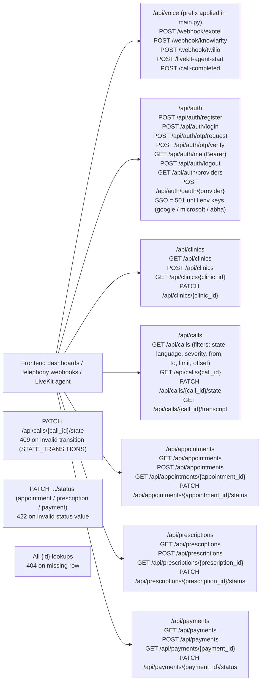

# 03 — API Contracts

## Notes

- Three routers (clinics, calls, appointments, prescriptions, payments — five
  modules) each declare `APIRouter(prefix="/api/<name>")`; `voice` is registered
  with the `/api/voice` prefix and `auth` with `prefix="/api/auth"` in `main.py`
  (all seven routers included).
- This endpoint set is the executable contract in
  `backend/tests/test_api_routes.py` (`EXPECTED_ENDPOINTS`) and the basis for the
  Docker/CI HTTP smoke tests.
- Contract behaviors: 409 invalid state transition, 422 invalid status, 404
  missing row — all acceptance-tested.
- Auth contract (G6-Q1, spec-auth.md): password + OTP are live
  (`/api/auth/register|login|otp/*`); `GET /me` requires a Bearer JWT;
  SSO (`/oauth/{provider}`) returns 501 until the Google/Microsoft/ABHA env
  keys are configured.
- `POST /api/payments` records an intent row only; it never calls a gateway SDK
  (G6-Q5 gated).