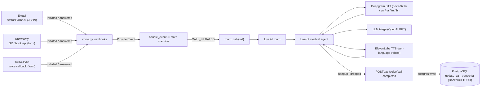

# 04 — Voice Pipeline Data Flow

## Notes

- **3-provider fallback chain** (locked): Exotel → Knowlarity → Twilio-India.
  Parsers in `backend/app/services/telephony.py` normalize to `ProviderEvent`
  (stdlib, unit-tested in G4); `voice.py` maps events to responses + dispatch.
- **Dispatch** (`POST /livekit-agent-start`) targets room `call-{sid}` in the
  caller's language; the LiveKit agent runs the `CallState` machine.
- **STT/TTS**: Deepgram `nova-3` and ElevenLabs across hi/en/ta/te/bn (the
  five locked languages; `language_codes` seed row in `postgres_schema.sql`).
- **Transcript persistence** (`update_call_transcript`) is a TODO owned by the
  Docker/CI stage — `voice.py` returns `saved` but the postgres write lands once
  sqlalchemy is in the runtime image (idempotent, keyed by `call_id`).
- Grey dashed edge = Docker/CI-stage work, not yet live.