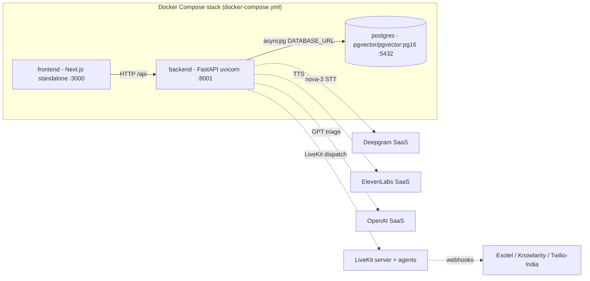

# 05 — Deployment

## Notes

- **Single stack entry**: `docker compose up` — backend health-gated on postgres;
  `backend/postgres_schema.sql` mounted as the postgres init script (extension,
  tables, RLS FORCE, grants, seed languages). Three services: postgres+pgvector,
  backend, frontend (G6-Q10 Q1=A1: the cache client has no callers — not in the
  stack). backend builds from the repo root (`context: .`), so the same
  `backend/Dockerfile` serves docker compose and Railway (Q2=A1).
- **Ports**: frontend `3000`, backend `8001→8000` (container), postgres `5432`;
  bridge network `medicall-local`, volume `postgres-data`.
- **Env contract**: `DATABASE_URL` (asyncpg scheme), `FRONTEND_URL`, and the DPDP
  block (`DATA_RESIDENCY_REGION=in` + retention days + DPO) at compose; plus
  STT/TTS/LLM/telephony/payment/notification keys at runtime (Deepgram,
  ElevenLabs, OpenAI, Exotel / Knowlarity / Twilio India, LiveKit, gateways).
  Full list + secret flags: `docs/DEPLOYMENT.md` env catalog.
- **Region pin (G6-Q10 Q3=A2)**: frontend = Vercel `bom1` (Mumbai, vercel.json);
  backend + Postgres = Railway `asia-southeast1` (nearest available — Railway
  has no Mumbai region as of 2026-09-25); `DATA_RESIDENCY_REGION="in"` is the
  documented posture with zero-retention BAAs (docs/DEPLOYMENT.md).
- **Retention purge (G6-Q10 Q4=A3)**: `backend/scripts/purge_expired.py` runs on
  `.github/workflows/purge.yml` (daily 03:00 UTC).
- **External SaaS**: LiveKit (rooms + agents), Deepgram, ElevenLabs, OpenAI, and
  the three telephony providers are deployed outside the stack.
- Payment gateways (razorpay / phonepe / cashfree) are env-gated wiring
  (spec-payments.md G6-Q5): the router dispatches only when keys are present
  (501 otherwise) and the verified webhook lands on the same host; live
  round-trips run behind CI secrets. Real credentials live in compose / CI /
  the Railway dashboard — never in the repo.