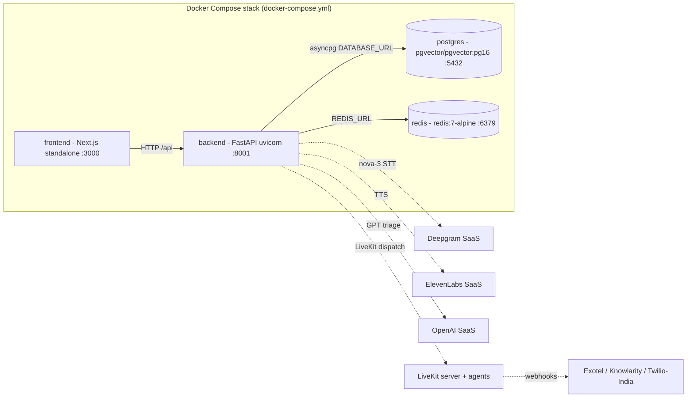

# 05 — Deployment

## Notes

- **Single stack entry**: `docker compose up` — backend health-gated on postgres +
  redis; `backend/postgres_schema.sql` mounted as the postgres init script
  (extension, tables, RLS, grants, seed languages).
- **Ports**: frontend `3000`, backend `8001→8000` (container), postgres `5432`,
  redis `6379`; bridge network `medicall-local`, volumes `postgres-data`,
  `redis-data`.
- **Env contract**: `DATABASE_URL`, `REDIS_URL`, `FRONTEND_URL` (compose),
  plus STT/TTS/LLM/telephony keys at runtime (Deepgram, ElevenLabs, OpenAI,
  Exotel / Knowlarity / Twilio, LiveKit).
- **External SaaS**: LiveKit (rooms + agents), Deepgram, ElevenLabs, OpenAI, and
  the three telephony providers are deployed outside the stack.
- Payment gateways (razorpay / phonepe / cashfree) are env-gated wiring
  (spec-payments.md G6-Q5): the router dispatches only when keys are present
  (501 otherwise) and the verified webhook lands on the same host; live
  round-trips run behind CI secrets. Real credentials live in compose / CI
  secrets, never in the repo.