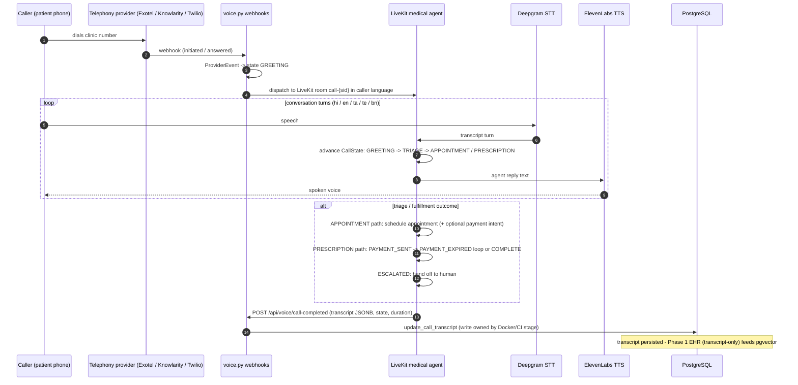

# 06 — Inbound Call Lifecycle (Sequence)

## Notes

- Lifecycle corresponds to the state machine in 02: GREETING → TRIAGE →
  APPOINTMENT / PRESCRIPTION, with ESCALATED / DROPPED exits and the
  PAYMENT_SENT → PAYMENT_EXPIRED loop.
- The payment leg shows the designed loop; real gateway SDK calls remain gated on
  the G6-Q5 decision — the API currently records payment intents only.
- The `/call-completed` → `update_call_transcript` DB write is a Docker/CI-stage
  TODO (idempotent, keyed by `call_id`), matching 04-data-flow.