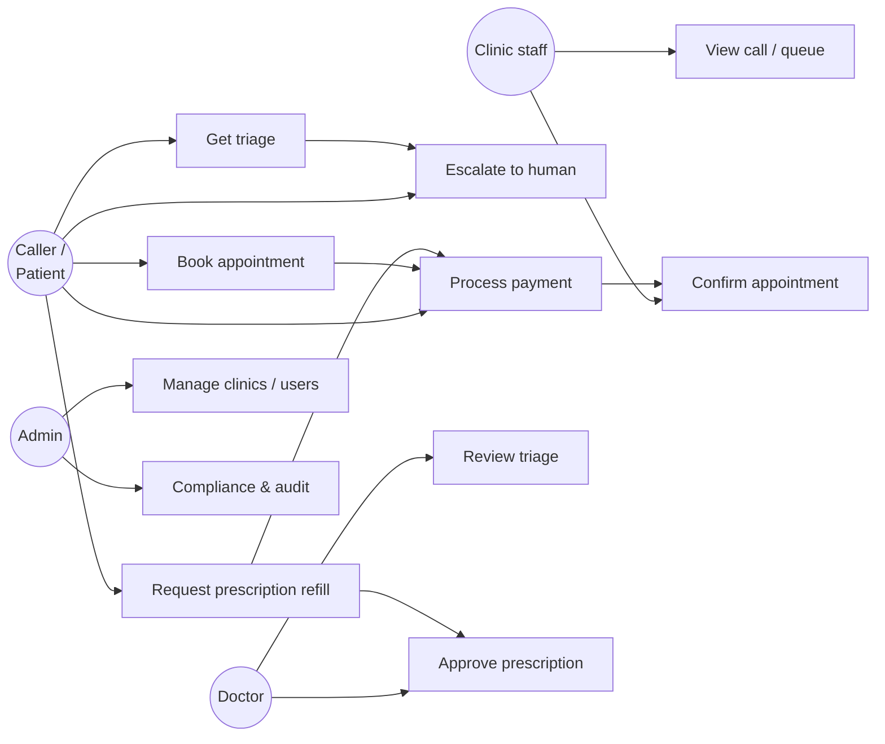

# 07 — Use Cases

## Notes

- **Actors** map to the RLS roles in `backend/postgres_schema.sql` (`clinic_users.role`:
  `owner / staff / triage_agent / doctor / readonly`) plus the anonymous
  `Caller/Patient` who reaches the system over the phone.
- **Primary actor** is the caller: `get triage` is the entry use case, `escalate`
  is included by it (guardrails in `app/services/guardrails.py` escalate on a
  red-flag keyword independent of the LLM).
- **`process payment`** is included by both `book appointment` and
  `request prescription refill` (G6-Q5 payments; the `PAYMENT_SENT` /
  `PAYMENT_EXPIRED` loop lives in the state machine, see 02-state-machine.md).
- **Doctor/Staff** use cases are the human-in-the-loop halves (confirm /
  approve) that resolve the state machine out of `APPOINTMENT` / `PRESCRIPTION`.
- **Admin** use cases (`manage clinics/users`, `compliance & audit`) are the
  multi-tenant operations over `/api/admin` and `/api/compliance`.
