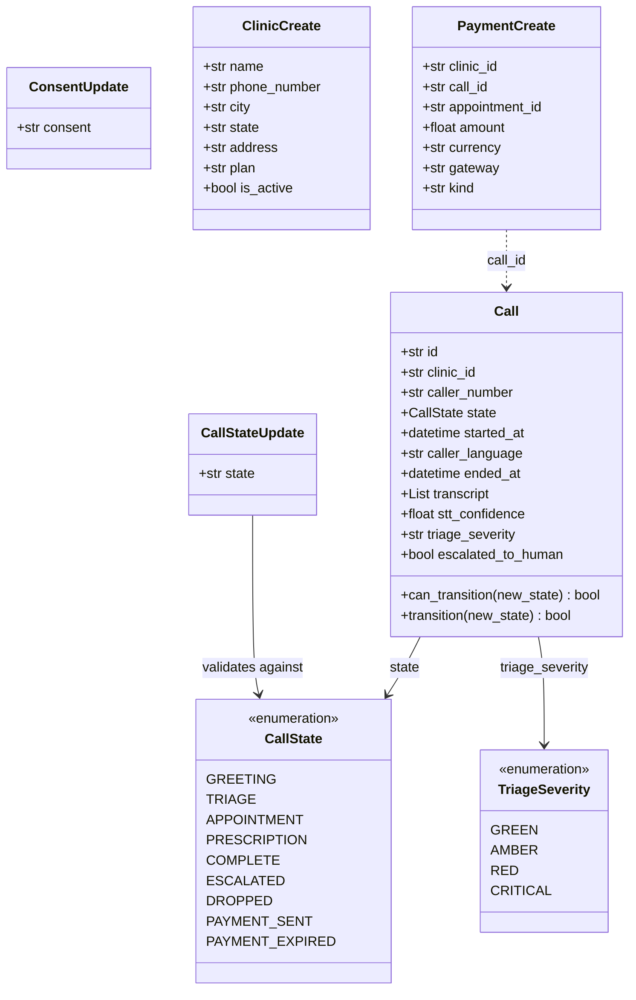

# 08 — Class Diagram

## Notes

- **Single source**: `backend/app/models/call.py` holds `CallState`, `TriageSeverity`,
  `STATE_TRANSITIONS`, and the `Call` dataclass. Request models live in
  `backend/app/schemas/` (Pydantic `BaseModel`); the router validates membership
  in `CallState` and `STATE_TRANSITIONS` (409 on invalid transition, see
  02-state-machine.md).
- **`Call` is a plain `@dataclass`** (stdlib, importable anywhere incl. the DB
  layer and agent workers), not an ORM model — persistence is SQLAlchemy in
  `backend/app/db/postgres.py`.
- **Enums are `str, Enum`**: `CallState` values are the uppercase wire names;
  `TriageSeverity` values are lowercase (`green / amber / red / critical`).
- **Request schemas are anemic DTOs** — they carry only what the client sends;
  the full row shape lives in `backend/postgres_schema.sql` (see 01-er.md).
